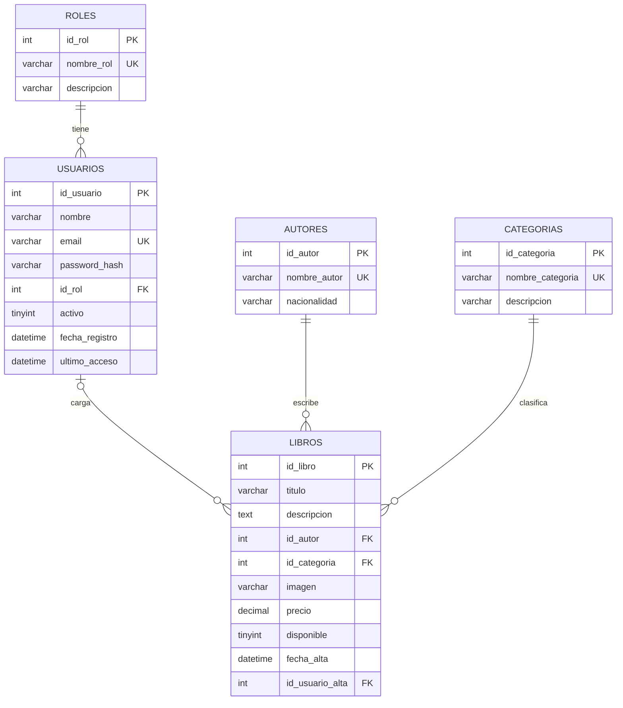

# Pasaje a tablas - Lofi-Library

Se parte del [MER](MER.png) y se aplican las reglas habituales de pasaje:

- **Cada entidad** pasa a ser una tabla. Sus atributos son los campos y el atributo subrayado en el MER es la **clave primaria (PK)**.
- **Relación 1:N**: la clave primaria del lado "1" viaja como **clave foránea (FK)** a la tabla del lado "N". No hace falta una tabla nueva.
- **Cardinalidad mínima 1** (por ejemplo, un usuario siempre tiene un rol): la FK es `NOT NULL`. **Cardinalidad mínima 0** (un libro puede no tener usuario que lo cargó): la FK admite `NULL`.

Todas las relaciones de este modelo son 1:N, por eso no aparecen tablas intermedias.

## 1. Esquema relacional

Notación: <ins>subrayado</ins> = clave primaria, *#FK* = clave foránea.

- ROLES (<ins>id_rol</ins>, nombre_rol, descripcion)
- USUARIOS (<ins>id_usuario</ins>, nombre, email, password_hash, *#id_rol*, activo, fecha_registro, ultimo_acceso)
- AUTORES (<ins>id_autor</ins>, nombre_autor, nacionalidad)
- CATEGORIAS (<ins>id_categoria</ins>, nombre_categoria, descripcion)
- LIBROS (<ins>id_libro</ins>, titulo, descripcion, *#id_autor*, *#id_categoria*, imagen, precio, disponible, fecha_alta, *#id_usuario_alta*)

## 2. Claves foráneas

| Tabla | Campo (FK) | Referencia | Cardinalidad | Al borrar el registro referenciado |
|---|---|---|---|---|
| USUARIOS | id_rol | ROLES.id_rol | Un rol tiene muchos usuarios (1:N). Obligatoria. | Se impide el borrado (RESTRICT) |
| LIBROS | id_categoria | CATEGORIAS.id_categoria | Una categoría tiene muchos libros (1:N). Obligatoria. | Se impide el borrado (RESTRICT) |
| LIBROS | id_autor | AUTORES.id_autor | Un autor tiene muchos libros (1:N). Obligatoria. | Se impide el borrado (RESTRICT) |
| LIBROS | id_usuario_alta | USUARIOS.id_usuario | Un usuario carga muchos libros (1:N). Opcional. | La FK pasa a NULL (SET NULL): el libro se conserva |

No se puede borrar un rol, un autor ni una categoría que todavía tenga usuarios o libros asociados. Si se elimina un usuario, los libros que cargó se conservan.

## 3. Tablas con sus campos

### ROLES

Perfiles de acceso al sistema (Administrador y Usuario).

| Campo | Tipo | Nulo | Clave |
|---|---|---|---|
| id_rol | INT | No | PK |
| nombre_rol | VARCHAR(30) | No | Único |
| descripcion | VARCHAR(150) | Sí | - |

### USUARIOS

Personas que pueden iniciar sesión en el sitio.

| Campo | Tipo | Nulo | Clave |
|---|---|---|---|
| id_usuario | INT | No | PK |
| nombre | VARCHAR(80) | No | - |
| email | VARCHAR(120) | No | Único |
| password_hash | VARCHAR(255) | No | - |
| id_rol | INT | No | FK -> ROLES.id_rol |
| activo | TINYINT(1) | No | - |
| fecha_registro | DATETIME | No | - |
| ultimo_acceso | DATETIME | Sí | - |

### AUTORES

Autores de los libros del catálogo.

| Campo | Tipo | Nulo | Clave |
|---|---|---|---|
| id_autor | INT | No | PK |
| nombre_autor | VARCHAR(100) | No | Único |
| nacionalidad | VARCHAR(60) | Sí | - |

### CATEGORIAS

Géneros o categorías en las que se clasifican los libros.

| Campo | Tipo | Nulo | Clave |
|---|---|---|---|
| id_categoria | INT | No | PK |
| nombre_categoria | VARCHAR(60) | No | Único |
| descripcion | VARCHAR(150) | Sí | - |

### LIBROS

Artículos del catálogo que se muestran en la landing page y se administran desde el dashboard.

| Campo | Tipo | Nulo | Clave |
|---|---|---|---|
| id_libro | INT | No | PK |
| titulo | VARCHAR(150) | No | - |
| descripcion | TEXT | Sí | - |
| id_autor | INT | No | FK -> AUTORES.id_autor |
| id_categoria | INT | No | FK -> CATEGORIAS.id_categoria |
| imagen | VARCHAR(255) | Sí | - |
| precio | DECIMAL(10,2) | Sí | - |
| disponible | TINYINT(1) | No | - |
| fecha_alta | DATETIME | No | - |
| id_usuario_alta | INT | Sí | FK -> USUARIOS.id_usuario |

La descripción de cada campo está en el [glosario de datos](glosario-de-datos.docx). El script que crea las tablas es [`api/config/init.sql`](../api/config/init.sql).

## 4. Diagrama relacional

Generado con Mermaid (GitHub lo dibuja automáticamente). Muestra las mismas tablas con las claves foráneas.

